# ousawedding

A Khmer and English wedding invitation website, published as a **static site** on Netlify (no server, no database; one small function sends RSVP alerts). Built with Nuxt 4. You edit everything in an admin dashboard that runs only on your computer; pushing your changes rebuilds the site on Netlify.

- Invitation: `/<slug>` (English) and `/km/<slug>` (Khmer), e.g. `/ousa-kanha`. The site root opens the default wedding; old `/wedding/<slug>` links redirect.
- Personal link: `/<slug>/<GuestName>`, e.g. `/ousa-kanha/MrCheaOusa`: the envelope and letter greet the guest by name (see *Personal links*).
- RSVP: a form on the invitation that sends each reply to you on Telegram, or a "Reply now" button to your own form (e.g. a Google Form), until the deadline.
- Admin (on your computer only): `http://localhost:8000/admin`

## Live site

- **https://ousawedding.netlify.app**: Netlify builds the static site from this repository on every push (see *Publish*).
- **GitHub Pages:** https://ousachea.github.io/ousawedding/ shows the earlier one-page invitation and no longer updates.

## What guests see

- **Envelope:** a purple envelope with gold trim and a gold foil seal. Opening it raises the letter ("You are warmly invited to celebrate our wedding"), then shows the invitation from the top. The page can't scroll behind it (iPhone included). The same tap goes fullscreen where the browser allows it (Android, iPad) and asks iPhone for motion access, for the tilting flowers.
- **Cover:** the couple's names, date and cover photo, with flowers in the corners that sway and lean as the phone tilts.
- **Schedule:** grouped by day, one column on phones. The line draws down with the reader and each item's dot fills in as it is reached. Below it, three cards of equal height: dress code with the wedding colours (the theme's purples and gold), guest information, and the contact numbers as call buttons.
- **Gallery:** a stack of up to five photos, all inside the screen, that plays non-stop while on screen. Swipe or tap a side photo to move; tap the middle one for full screen.
- **Reply:** "Can you make it?" as two cards (yes / no). Saying yes opens a guest counter; typing a name opens an optional phone number. Each reply is sent to the couple on Telegram, and the guest sees an animated thank-you.
- **Wedding gift:** the couple's KHQR codes, one row per bank with its logo. Tapping a bank opens its code (gold corners, a scan line) and closes the others; all close once the section is scrolled away. The code tilts under the finger, opens large when tapped, and can be saved to the phone's photos to scan from a banking app.
- **Around the page:** falling petals, butterflies in random pastel tints that gather around a finger on phones and tablets, and still greenery down both sides.
- **Navigation:** a slim top bar (monogram, music, language) and a floating gold bottom bar with an icon per section. Both tuck away while scrolling down and come back when scrolling up.
- Visitors who turn on *reduce motion* get the same page without the animations.

### Share previews

Each invitation has full share and search tags: the cover photo, the title, and the share text followed by the date and time, in Khmer or English. Settings → *Link preview* shows how the link will look in chat apps and in Google while you type.

## Screenshots

Taken from an earlier version with sample data: the envelope is now purple and gold, the gallery is a stack of photos, and the sections are in a bottom bar.

### Guest invitation (phone)

<table>
  <tr>
    <td align="center">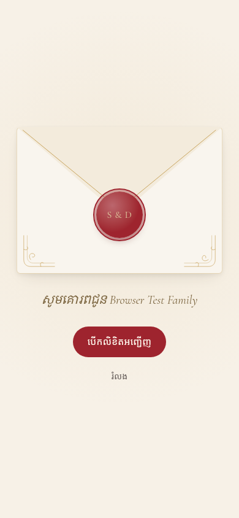<br>Envelope with the guest's name</td>
    <td align="center">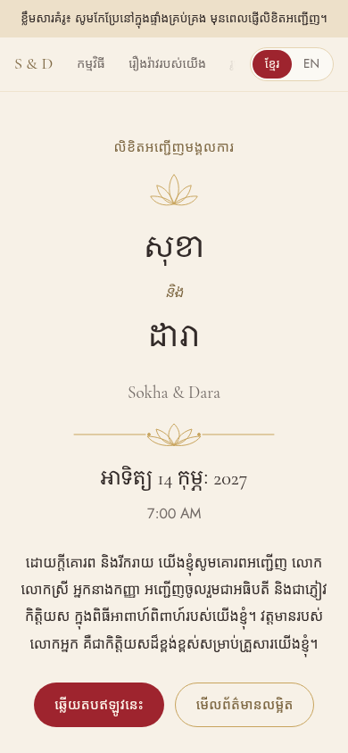<br>Invitation in Khmer</td>
    <td align="center">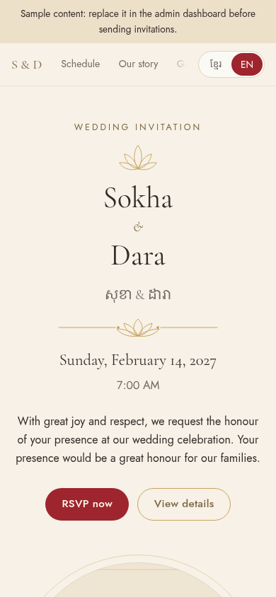<br>Invitation in English</td>
  </tr>
  <tr>
    <td align="center">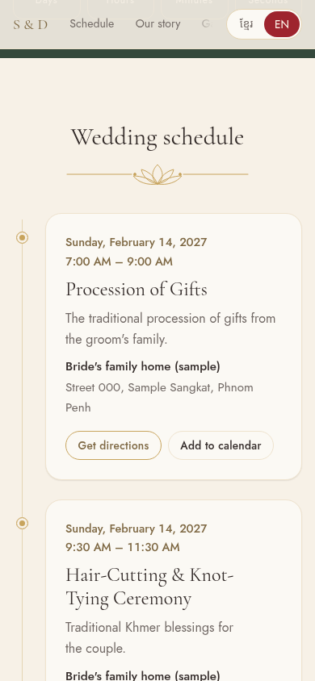<br>Schedule with directions and calendar</td>
    <td align="center">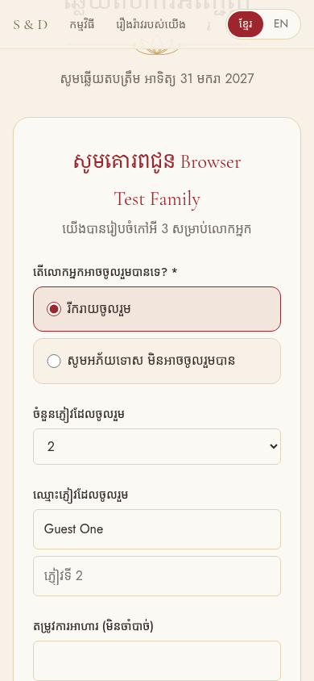<br>Personal RSVP form</td>
    <td align="center">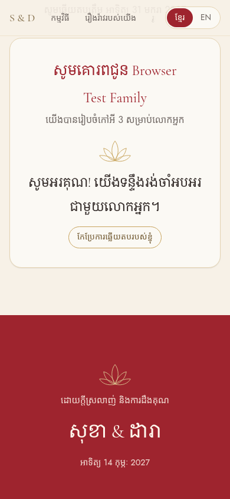<br>RSVP confirmation</td>
  </tr>
  <tr>
    <td align="center">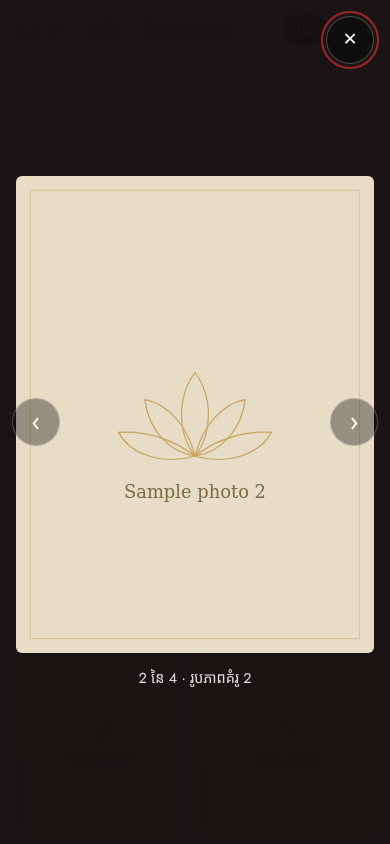<br>Photo viewer</td>
    <td align="center">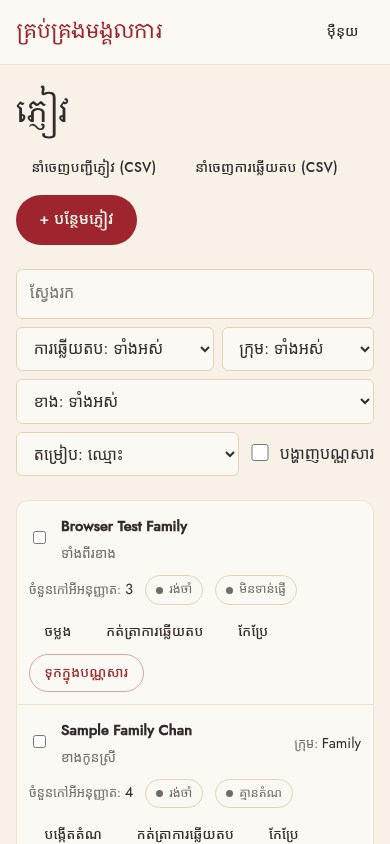<br>Admin guest list on a phone</td>
    <td></td>
  </tr>
</table>

### Desktop

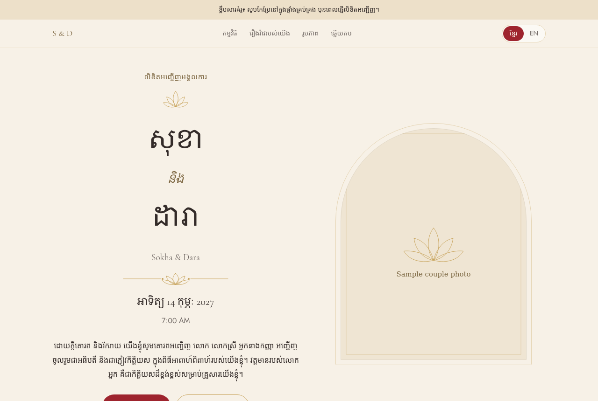

### Admin dashboard

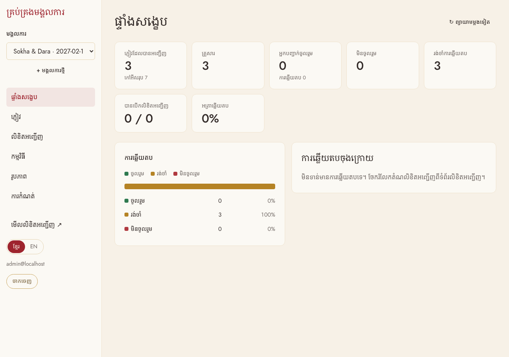

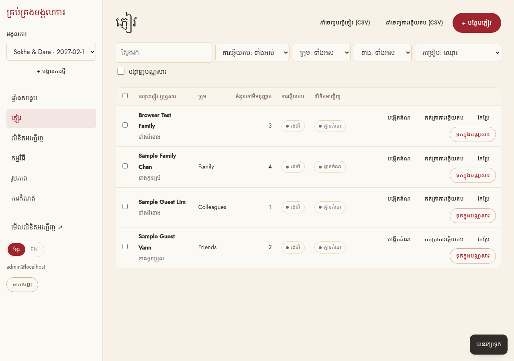

<details>
<summary>Invitations page (publishing, phone preview, personal links)</summary>

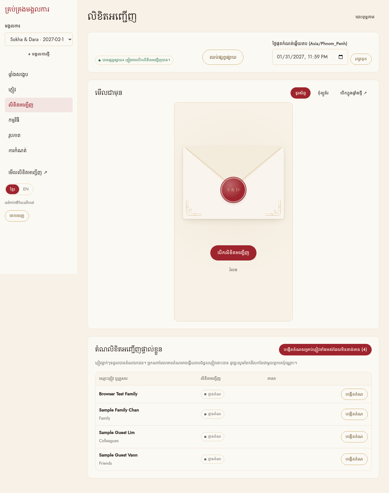

</details>

## Run locally and edit

```sh
npm install --no-bin-links   # --no-bin-links is only needed on Android shared storage
cp .env.example .env         # admin password (for other devices) and the live site address
npm run dev                  # http://localhost:8000/admin
```

On the computer running `npm run dev`, `http://localhost:8000/admin` opens without a password. The dev server can also be reached from other devices on the same network (for example a tablet); those sign in with `NUXT_LOCAL_ADMIN_PASSWORD`.

The admin saves to files in the project:

| Where | What | Published? |
|---|---|---|
| `content/` | wedding, schedule, gallery (`weddings.json`, `events.json`, `gallery.json`) | yes, committed |
| `public/uploads/` | uploaded photos | yes, committed |
| `.data/local/guests.json` | guest list (names, phones, notes) | **no**: git ignores it, so it never reaches the public repository |

When there is no content yet, the app starts with sample content.

## Publish

Commit and push the content; Netlify rebuilds the static site (about a minute):

```sh
git add content public/uploads
git commit -m "Update invitation"
git push
```

`npm run build` generates every page into static files (`netlify.toml` tells Netlify to publish `dist/`). The live address, used in share previews, personal links and calendar files, is the one Netlify gives the build (`https://ousawedding.netlify.app` otherwise, in `nuxt.config.ts`); set `NUXT_PUBLIC_SITE_URL` on Netlify to use another. The only secrets are the two Telegram settings below.

Uploaded photos are named by a unique ID and never change, so `netlify.toml` lets browsers cache them for a year; pages are always re-checked, so changes show up straight away.

### RSVP replies

The invitation has its own form (name, attending, number of guests, optional phone and message). Each reply is sent to you on Telegram by `netlify/functions/rsvp.ts` (on the dev server, `server/api/rsvp.post.ts`). Set `TELEGRAM_BOT_TOKEN` and `TELEGRAM_CHAT_ID` in `.env` and in Netlify (Site configuration → Environment variables): create a bot with @BotFather, send it a message, then find your chat ID at `https://api.telegram.org/bot<token>/getUpdates`.

To use a Google Form instead, paste its link in **Settings → RSVP**; the invitation then shows a button to it. Either way, replies close at the RSVP deadline.

### Personal links

**Invitations** lists a link and QR code per guest (Khmer or English), with printable cards, and builds a link for any name you type. A link is just the invitation address plus the guest's name, so nothing is tracked and anyone with a link can see the name in it.

You can also type a link by hand: add the guest's name after the address, without spaces. Add `/km` before the wedding for the Khmer invitation.

```
https://ousawedding.netlify.app/ousa-kanha/MrCheaOusa
https://ousawedding.netlify.app/km/ousa-kanha/MrCheaOusa
```

The name is split at each capital letter (`CheaOusa` → Chea Ousa); a dash or underscore also works (`chea-ousa`). Khmer names are shown exactly as typed. A title at the start is written out in the invitation's language:

| Type in the link | English invitation | Khmer invitation |
|---|---|---|
| `MrCheaOusa` | Mr. Chea Ousa | លោក Chea Ousa |
| `MrsCheaOusa` | Mrs. Chea Ousa | លោកស្រី Chea Ousa |
| `MrAndMrsCheaOusa` | Mr. & Mrs. Chea Ousa | លោក និងលោកស្រី Chea Ousa |
| `MsChea` | Ms. Chea | អ្នកនាង Chea |
| `MissSokha` | Miss Sokha | កញ្ញា Sokha |
| `DrSokDara` | Dr. Sok Dara | បណ្ឌិត Sok Dara |
| `HECheaOusa` | H.E. Chea Ousa | ឯកឧត្តម Chea Ousa |
| `HEAndLokChumteavCheaOusa` | H.E. & Lok Chumteav Chea Ousa | ឯកឧត្តម និងលោកជំទាវ Chea Ousa |
| `LokChumteavSokha` | Lok Chumteav Sokha | លោកជំទាវ Sokha |
| `OknhaSokDara` | Oknha Sok Dara | អ្នកឧកញ៉ា Sok Dara |
| `OknhaAndLokChumteavSokDara` | Oknha & Lok Chumteav Sok Dara | អ្នកឧកញ៉ា និងលោកជំទាវ Sok Dara |
| `SamdechSokDara` | Samdech Sok Dara | សម្តេច Sok Dara |
| `LokKruSokha` | Lok Kru Sokha | លោកគ្រូ Sokha |
| `NeakKruDara` | Neak Kru Dara | អ្នកគ្រូ Dara |

Tips:

- Start the name with a capital after the title (`MrSokha`, not `Mrsokha`), or use dashes (`mr-sokha`).
- For couples write `MrAndMrs`, not `Mr&Mrs`: a `&` can break a link.
- The title also shows in chat-app link previews. The RSVP form is filled with the name alone.
- Titles and spacing are in `guestNameFromLink` (`shared/utils/wedding.ts`); the short address is a redirect in `public/_redirects` (and `server/middleware/guest-path.ts` on the dev server).

### Wedding gift (KHQR)

In **Settings → Wedding gift**, add up to four KHQR images (from your banking app: receive money, save the QR) with the account name and bank. Each upload is cropped to the code alone, so every code shows at the same size. Banks named ABA, ACLEDA or Canadia show their logo (`public/banks/`). The section is hidden until a code is added.

### Checks

```sh
npm run typecheck
npm run build:server && npm test   # admin API + server-rendered pages, plus timezone unit tests
npm run build                      # the static site, into .output/public (dist/ on Netlify)
```

## How it's built

```
app/
  pages/[slug].vue                 Public invitation (one scrolling page)
  pages/admin/*                    Dashboard, guests, invitations (+ print), schedule, gallery, theme, settings
  components/wedding/*             Envelope, hero, countdown, schedule, gallery, flowers, petals, butterflies,
                                   greenery, RSVP, top bar and bottom bar…
  components/admin/*               Live preview, link preview, modal, QR code, bilingual field, stat card
  composables/*                    Shared page state (e.g. hiding the bars while scrolling)
i18n/locales/{km,en}.json          Interface text
server/
  api/public/*                     Wedding content and calendar files (.ics), read when the site is built
  api/admin/*, api/auth/*          The admin dashboard's API (on your computer only)
  utils/db.ts                      JSON files: content/ (public) and .data/local/ (private)
  utils/storage.ts                 Photo uploads into public/uploads/
shared/                            Types, timezone, link and share-preview helpers used by both sides
content/                           The published wedding content
tests/                             node:test suites
```

Wedding content is stored in both languages; interface text is in the locale files. English is the default language, and Khmer lives under `/km`; old `/en/` links redirect.

### Privacy

- The repository is public, so only what the invitation shows is committed. The guest list stays on your computer.
- Guest names in personal links are read in the browser; the pages themselves are the same files for everyone. Pages are `noindex` unless you turn indexing on in Settings.
- Uploads are checked by their real file type, size-capped and resized in the browser.

### Backups

Your content is in git. Settings → Backup also downloads one JSON file with the wedding, schedule, gallery and guest list (keep that file private).
