# ousawedding

A Khmer and English wedding invitation website, published as a **static site** (no server, no database). Built with Nuxt 4. You edit everything in an admin dashboard that runs only on your computer; pushing your changes rebuilds the site on Vercel or Netlify.

- Invitation: `/<slug>` (Khmer) and `/en/<slug>` (English), e.g. `/ousa-kanha`. The site root opens the default wedding; old `/wedding/<slug>` links redirect.
- Personal link: `/<slug>?to=<guest name>`: the envelope greets the guest by name.
- RSVP: a "Reply now" button that opens your Google Form (or any form) until the deadline.
- Admin (on your computer only): `http://localhost:8000/admin`

## Live site

- **Vercel / Netlify:** both build the static site from this repository on every push (see *Publish*).
- **GitHub Pages:** https://ousachea.github.io/ousawedding/ shows the earlier one-page invitation and no longer updates.

## Screenshots

Taken from the app running with sample data.

### Guest invitation (phone)

<table>
  <tr>
    <td align="center">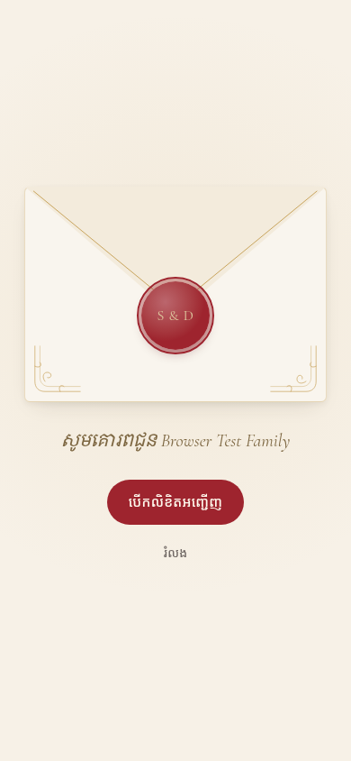<br>Envelope with the guest's name</td>
    <td align="center">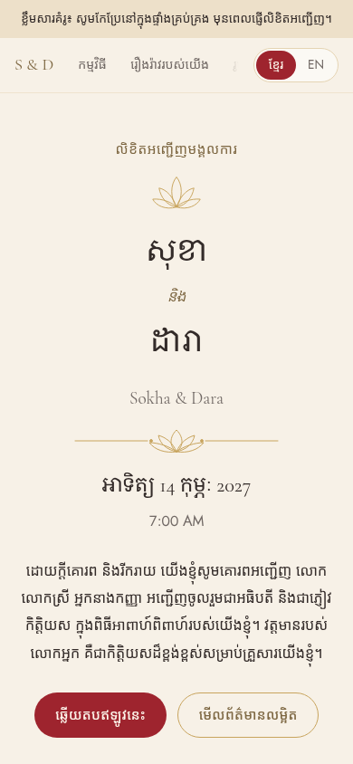<br>Invitation in Khmer</td>
    <td align="center">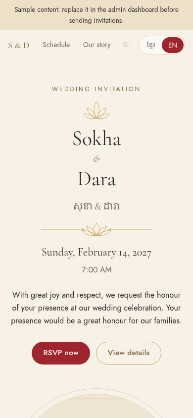<br>Invitation in English</td>
  </tr>
  <tr>
    <td align="center">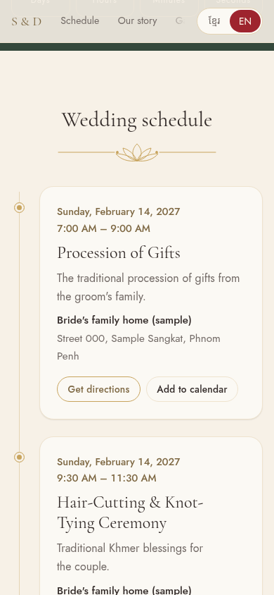<br>Schedule with directions and calendar</td>
    <td align="center">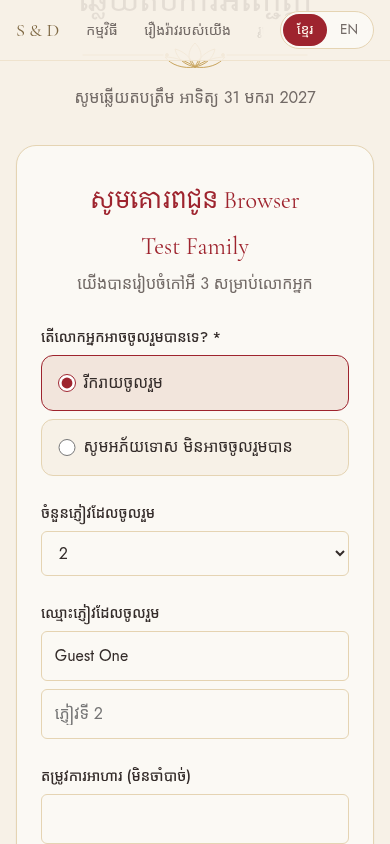<br>Personal RSVP form</td>
    <td align="center">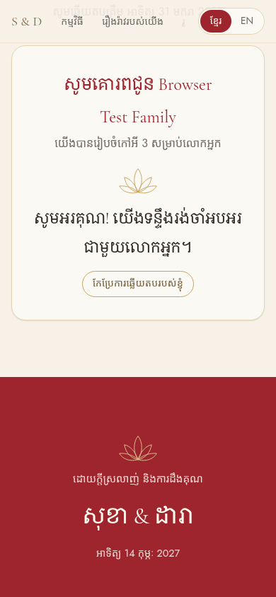<br>RSVP confirmation</td>
  </tr>
  <tr>
    <td align="center">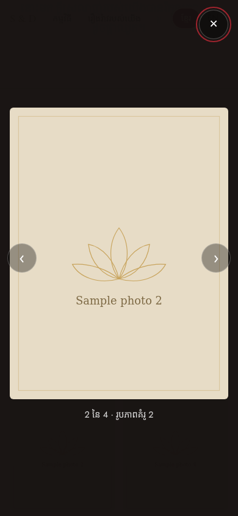<br>Photo viewer</td>
    <td align="center">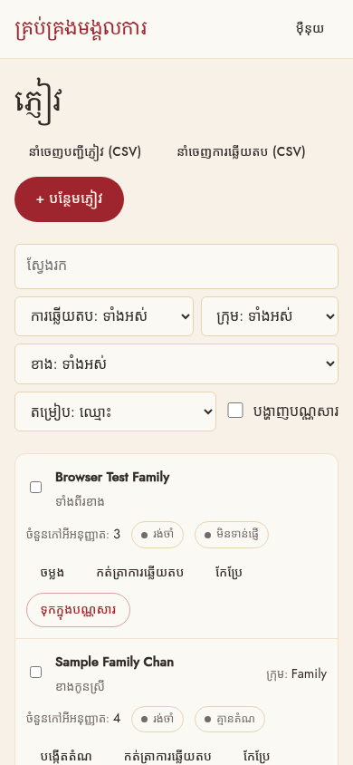<br>Admin guest list on a phone</td>
    <td></td>
  </tr>
</table>

### Desktop

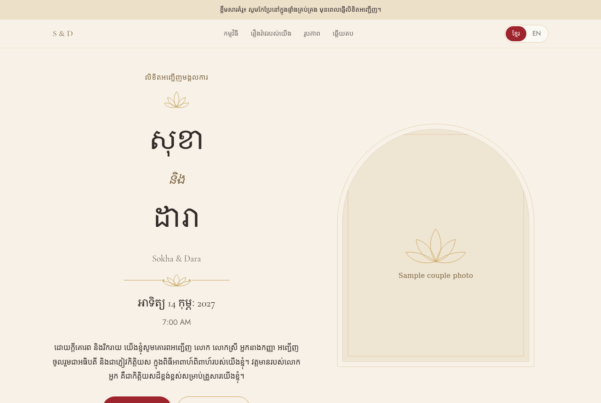

### Admin dashboard

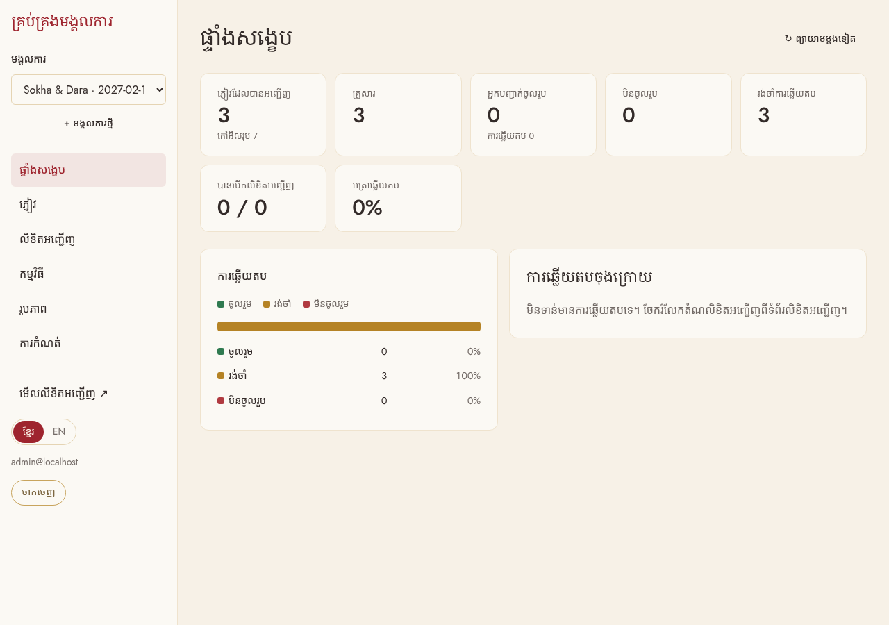

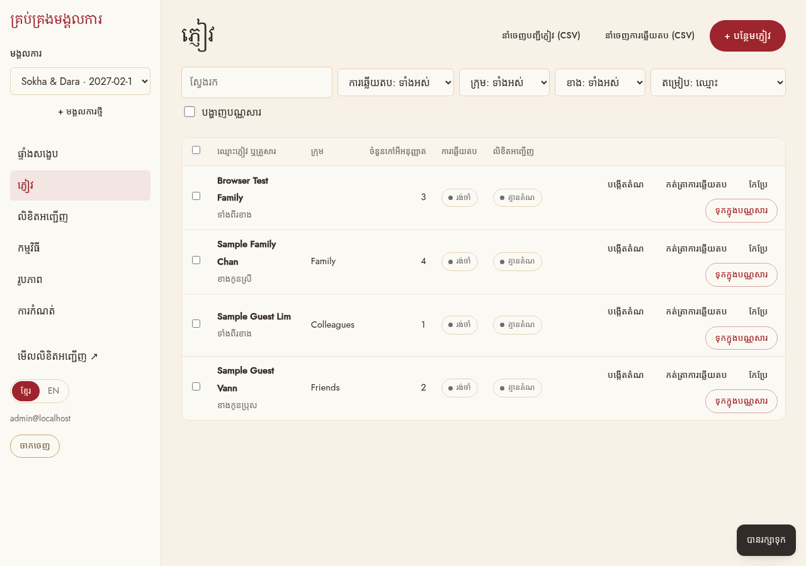

<details>
<summary>Invitations page (publishing, phone preview, personal links)</summary>

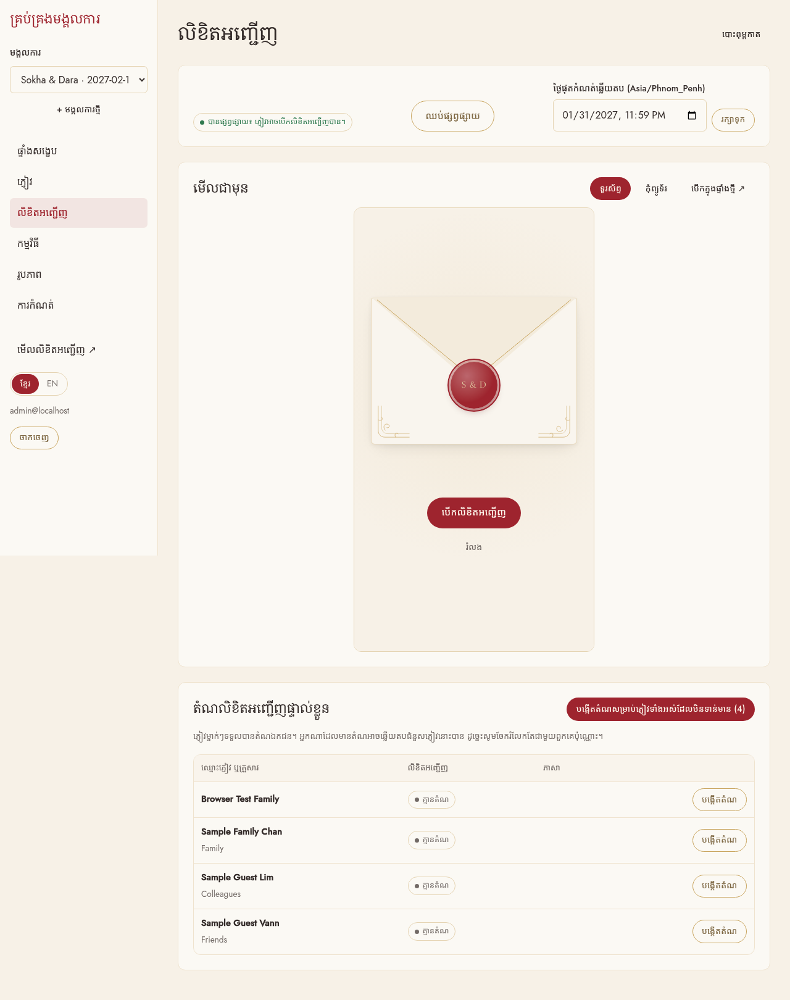

</details>

## Run locally and edit

```sh
npm install --no-bin-links   # --no-bin-links is only needed on Android shared storage
cp .env.example .env         # set your admin password and the live site address
npm run dev                  # http://localhost:8000/admin
```

The admin saves to files in the project:

| Where | What | Published? |
|---|---|---|
| `content/` | wedding, schedule, gallery (`weddings.json`, `events.json`, `gallery.json`) | yes, committed |
| `public/uploads/` | uploaded photos | yes, committed |
| `.data/local/guests.json` | guest list (names, phones, notes) | **no**: git ignores it, so it never reaches the public repository |

When there is no content yet, the app starts with sample content.

## Publish

Commit and push the content; Vercel or Netlify rebuilds the static site (about a minute):

```sh
git add content public/uploads
git commit -m "Update invitation"
git push
```

`npm run build` generates every page into static files (Vercel detects this automatically; `netlify.toml` tells Netlify to publish `dist/`). Set `NUXT_PUBLIC_SITE_URL` on the host too, so share previews and calendar files use the live address. No other settings or secrets are needed.

### RSVP replies

Create a Google Form (name, attending, number of guests, message…), paste its link in **Settings → RSVP**, and replies collect in the form's Google Sheet. The invitation shows the button until the RSVP deadline.

### Personal links

**Invitations** lists a link and QR code per guest (Khmer or English), with printable cards. A link is just the invitation address plus the guest's name, so nothing is tracked and anyone with a link can see the name in it.

### Checks

```sh
npm run typecheck
npm run build:server && npm test   # admin API + server-rendered pages, plus timezone unit tests
npm run build                      # the static site, into .output/public (dist/ on Netlify)
```

## How it's built

```
app/
  pages/[slug].vue                 Public invitation (one scrolling page)
  pages/admin/*                    Dashboard, guests, invitations (+ print), schedule, gallery, theme, settings
  components/wedding/*             Envelope, hero, countdown, schedule, gallery, flowers, RSVP, navigation…
  components/admin/*               Live preview, modal, QR code, bilingual field, stat card
i18n/locales/{km,en}.json          Interface text
server/
  api/public/*                     Wedding content and calendar files (.ics), read when the site is built
  api/admin/*, api/auth/*          The admin dashboard's API (on your computer only)
  utils/db.ts                      JSON files: content/ (public) and .data/local/ (private)
  utils/storage.ts                 Photo uploads into public/uploads/
shared/                            Types, timezone and link helpers used by both sides
content/                           The published wedding content
tests/                             node:test suites
```

Wedding content is stored in both languages; interface text is in the locale files. Khmer is the default language, and English lives under `/en`.

### Privacy

- The repository is public, so only what the invitation shows is committed. The guest list stays on your computer.
- Guest names in personal links are read in the browser; the pages themselves are the same files for everyone. Pages are `noindex` unless you turn indexing on in Settings.
- Uploads are checked by their real file type, size-capped and resized in the browser.

### Backups

Your content is in git. Settings → Backup also downloads one JSON file with the wedding, schedule, gallery and guest list (keep that file private).
